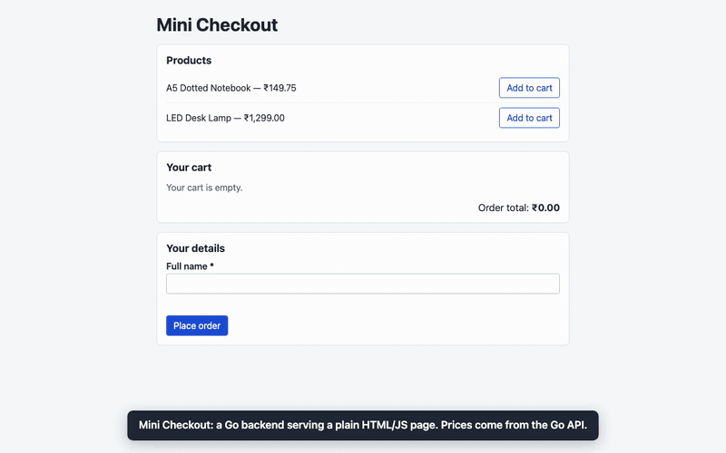
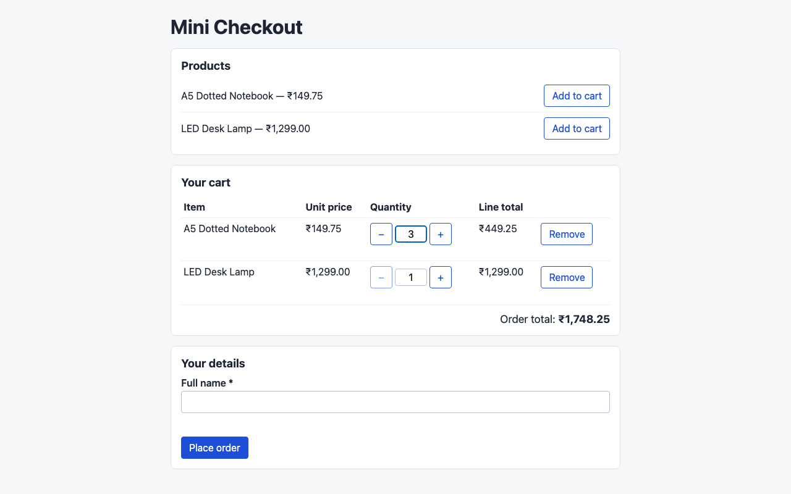
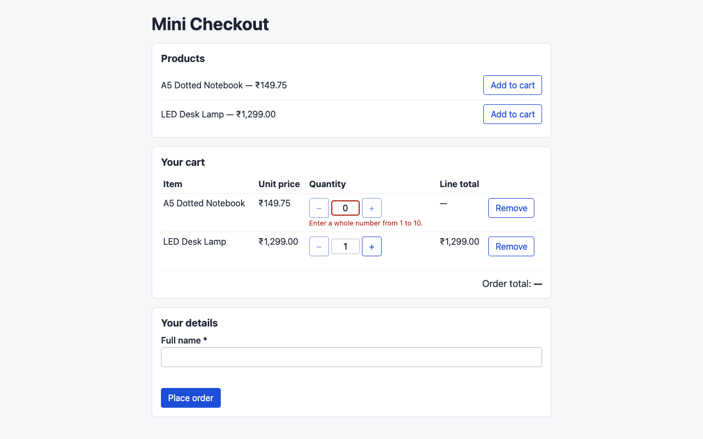
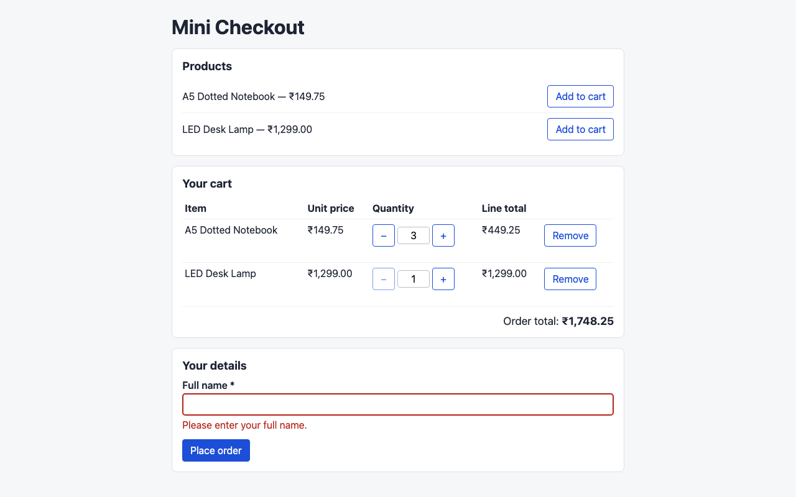
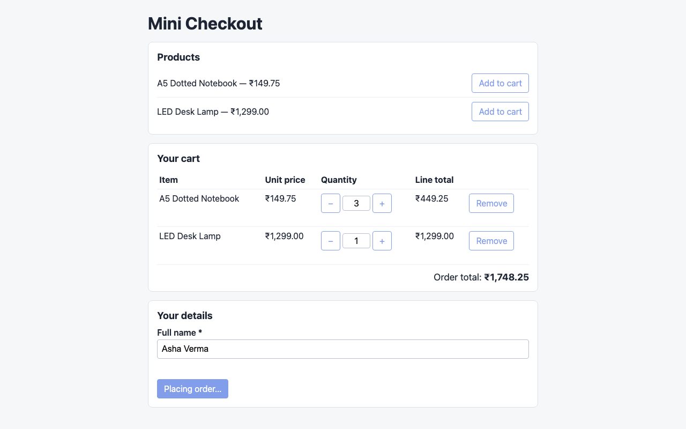
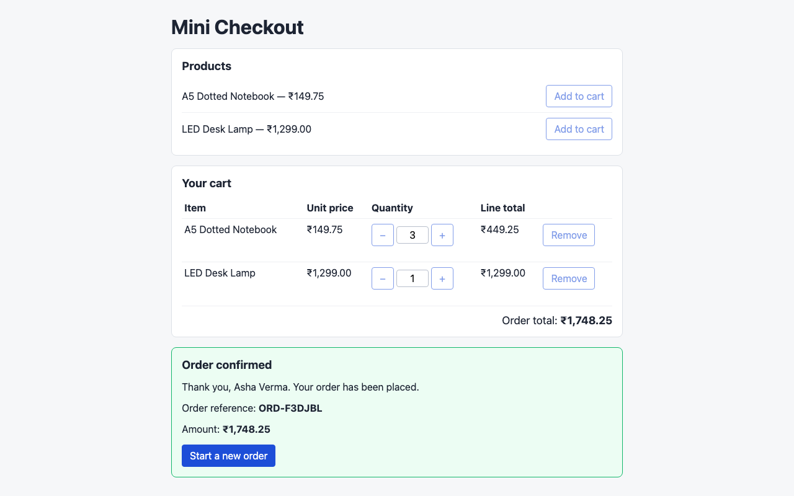
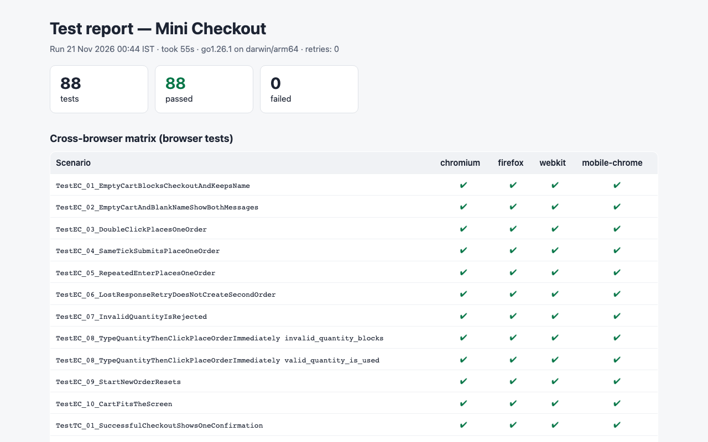
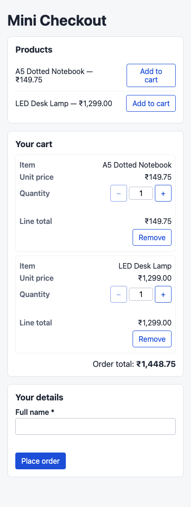
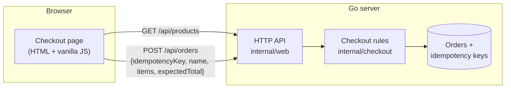
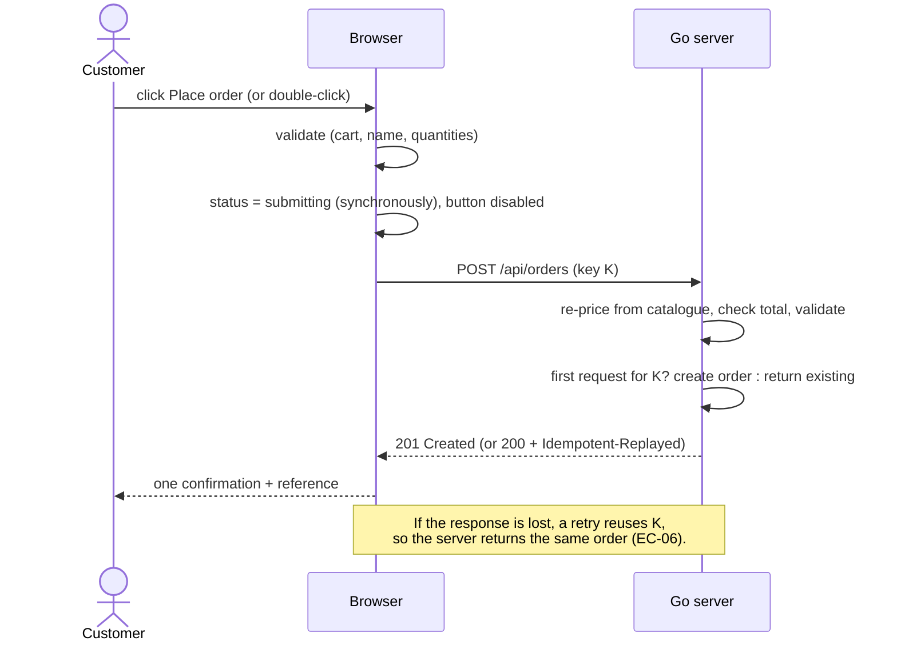

# Mini Checkout & Browser Test Suite

[](https://github.com/JaipreethTiruvaipati/fynd-mini-checkout-sdet/actions/workflows/ci.yml)


**Fynd Hiring Hackathon, Nov 2026 · SDET Intern track**

A single-page checkout with a **Go backend**, tested in real browsers with **Playwright for Go** on four browser profiles. Includes a risk-based test plan, manual test results and **three real defects** found, reported with evidence, fixed and covered by regression tests.



▶ **[Watch the demo video (51 s, captioned)](https://jaipreethtiruvaipati.github.io/fynd-mini-checkout-sdet/)** · **[Slides](https://jaipreethtiruvaipati.github.io/fynd-mini-checkout-sdet/presentation.html)** · **[Test report](https://jaipreethtiruvaipati.github.io/fynd-mini-checkout-sdet/report/)**

---

## At a glance

| | |
|---|---|
| **Tests** | **28 unit** (Go, `-race`) + **60 browser** (15 scenarios × Chromium, Firefox, WebKit, Pixel 7), **all passing, 0 retries** |
| **Required checks** | ✅ success → one confirmation · ✅ missing name blocks checkout · ✅ quantity change → exact total |
| **Manual tests** | ✅ empty cart · ✅ rapid double-click (verified in UI **and** server log) |
| **Defects found** | **DEF-01** order placed despite a qty error · **DEF-02** click ignored in Firefox/WebKit · **DEF-03** Remove off-screen on phones (all fixed) |
| **Open issue** | **FLAKE-01** intermittent Firefox failure (2 in 39 runs), investigated and documented, not hidden by retries |
| **Duplicate orders** | Prevented at **two layers**: browser guard + server **idempotency key**. Tested with double-click, same-tick submits, repeated Enter, a **lost-response retry**, and 50 concurrent goroutines |

## Screenshots

| Cart with exact totals | Invalid quantity |
|---|---|
|  |  |
| **Missing name blocks checkout** | **Double-click: button locks at once** |
|  |  |
| **One confirmation with reference** | **Test report: every scenario on every engine** |
|  |  |

<details>
<summary>Phone layout (DEF-03 fix)</summary>


</details>

## Quick start

Requires **Go 1.26+**.

```bash
# Run the app
go run ./cmd/server                  # http://127.0.0.1:8080
go run ./cmd/server -order-delay 2s  # slower "processing" to try double-clicking by hand

# Unit tests
go test -race ./...

# Browser tests (one-time browser install, ~300 MB)
go run github.com/mxschmitt/playwright-go/cmd/playwright@v0.6401.0 install --with-deps
go test -tags e2e ./e2e -v                          # all 4 profiles
BROWSERS=webkit go test -tags e2e ./e2e -v          # one engine
HEADED=1 BROWSERS=chromium go test -tags e2e ./e2e -run TestTC_01 -v   # watch it run

# HTML report
go test -json ./internal/... > unit.json; go test -tags e2e -json ./e2e > e2e.json
go run ./cmd/testreport -o docs/report/index.html unit.json e2e.json

# Re-record the demo video and screenshots (needs ffmpeg)
go run ./cmd/demo && ./scripts/make-demo-video.sh
```

## How it works



**Placing an order**



### Design decisions

| Decision | Why |
|---|---|
| **Money as integer paise** (`type Paise int64`) | `3 × 149.75` in floating point is `449.24999…`. Integers are exact. The ₹149.75 test price was chosen to catch this |
| **Server re-prices every order** | Never trust prices from the browser. If the total differs from what the customer saw, the order is refused (`409 price_changed`) rather than charging a surprise amount |
| **Idempotency key per checkout attempt** | The browser guard stops double-clicks; the key also covers retries after a lost response, a second tab, or scripts. Concurrent duplicates wait for the first request and get the same order |
| **Cart rows updated in place, never rebuilt** | Rebuilding the DOM mid-click caused DEF-02 (clicks lost in Firefox/WebKit) |
| **Totals show "—" while a quantity is invalid** | Never show a number that doesn't match what the customer typed |
| **Single binary** | The page is embedded with `go:embed`; `go run ./cmd/server` is all you need |
| **Readable references** (`ORD-` + 6 chars, no 0/O/1/I) | Easy to read out on a support call |

## Test strategy

```
                ┌──────────────────────────────┐
                │ Manual + exploratory (Chrome)│  MT-01 empty cart · MT-02 double-click
                └──────────────────────────────┘    (found DEF-01)
          ┌──────────────────────────────────────────┐
          │ Browser tests: Go + playwright-go         │  15 scenarios × 4 browser profiles
          │ Chromium · Firefox · WebKit · Pixel 7     │  (found DEF-02, DEF-03)
          └──────────────────────────────────────────┘
    ┌───────────────────────────────────────────────────────┐
    │ Unit tests: Go, table-driven, -race                    │  pricing, INR format, 10 validation
    │                                                        │  rules, idempotency, 50 concurrent
    └───────────────────────────────────────────────────────┘  requests, HTTP codes
```

- **Clean state per test:** each browser test gets its **own Go server** (empty order store) and a new browser context, and first asserts the empty starting state.
- **Assert what the customer sees:** role/label locators and exact ₹ text, never CSS-only checks on visible behaviour.
- **…and the source of truth:** tests read the server's order store to prove *exactly one order* and *charged exactly the amount shown*.
- **No fixed waits:** web-first assertions only. **No retries:** flakiness gets investigated (FLAKE-01), not hidden.
- **Failure diagnostics:** every failure saves a screenshot plus a timestamped log of browser requests, responses, console output and JS errors.
- **Testing the tests:** I injected bugs on purpose and confirmed the suite catches each one ([results §4](docs/TEST_RESULTS.md#4-do-the-tests-catch-real-bugs-mutation-check)).

📄 **[Test plan](docs/TEST_PLAN.md)**: risks ranked by impact, test cases, entry/exit criteria, gaps
📄 **[Test results & defect reports](docs/TEST_RESULTS.md)**: matrix, manual tests, DEF-01..03, FLAKE-01

## Defects found

| ID | Severity | Summary | Found by | Status |
|---|---|---|---|---|
| [DEF-01](docs/TEST_RESULTS.md#def-01-order-placed-while-a-quantity-error-is-on-screen-major-fixed) | Major | Typing `0` and clicking Place order immediately placed an order **while showing an error** | Exploratory testing | Fixed + EC-07/EC-08 |
| [DEF-02](docs/TEST_RESULTS.md#def-02-first-click-on-place-order-ignored-in-firefox-and-webkit-after-editing-a-quantity-major-fixed) | Major | After editing a quantity, the first click on Place order was **silently ignored** in Firefox/WebKit (Chromium fine) | Cross-browser run | Fixed + EC-08 ×4 browsers |
| [DEF-03](docs/TEST_RESULTS.md#def-03-cart-overflows-on-phones-remove-button-off-screen-minor-fixed) | Minor | On a 412 px phone the page overflowed to 509 px; **Remove was off-screen** | Mobile profile | Fixed + EC-10 |

DEF-02 is the reason this suite runs on more than one engine. A Chrome-only suite was green the whole time.

## Project structure

```
cmd/server/          main: HTTP server with graceful shutdown
cmd/testreport/      go test -json → HTML report
cmd/demo/            records the demo video + README screenshots with playwright-go
internal/checkout/   business rules: catalogue, Paise, INR format, validation, idempotent orders (+ tests)
internal/web/        HTTP API + embedded page (static/) (+ tests)
e2e/                 browser tests (build tag e2e): harness + scenarios
docs/                test plan, results, evidence, screenshots, demo, report, slides
.github/workflows/   CI: unit tests + browser tests per engine + HTML report artifact
```

## API

| Method | Path | Success | Errors |
|---|---|---|---|
| `GET` | `/api/products` | `200 {products:[{id,name,pricePaise}]}` | |
| `POST` | `/api/orders` | `201 {order}` new · `200 {order}` + `Idempotent-Replayed: true` repeat | `422` validation · `409` price changed / key reused · `400` bad JSON |

## Assumptions

- One currency (INR, Indian digit grouping), quantity 1–10 per product, two fixed synthetic products.
- Orders live in memory (no database), so a restart clears them. Production would persist orders and use a shared idempotency store.
- Payment is out of scope (as the brief says); order processing time is simulated with `-order-delay`.

